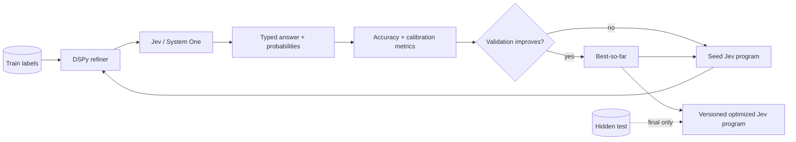

# DSPy × TypeSafe Jev Prompt Optimizer

A minimal outer-loop optimizer that uses **DSPy to propose better Jev question instructions/criteria**, evaluates each candidate with **TypeSafe AI Jev** on labeled examples, and keeps candidates that improve held-out accuracy.

The important separation is:

- **Jev** is the typed probabilistic decision engine being optimized.
- **DSPy** is the proposal/refinement layer generating candidate Jev programs.
- **Ordinary Python** owns the evaluation loop, dataset isolation, acceptance rule, and final deployment artifact.

## Architecture



The editable Mermaid source is [`architecture.mmd`](architecture.mmd). This is a **conceptual architecture**, including possible extensions: the starter below only optimizes one `Choice` question's instructions and criteria, reports accuracy/Macro-F1/Brier, and selects by accuracy then Brier. It does not implement decomposition, threshold/weight search, ECE/log loss, or cost/latency optimization. A generated program is not independently verified or automatically deployed.

### Rendering the diagram

The [diagram workflow](../../.github/workflows/render-dspy-jev-diagram.yml) uses Node.js 22, pnpm 10.34.5, and Mermaid CLI 11.17.0 to generate both vector SVG and a high-resolution PNG. It runs on relevant pushes to `example/dspy-jev-optimizer`; manual runs are restricted to that same branch. It does not automatically refresh diagrams on `main` or run on pull requests.

Rendering uses a read-only checkout with no persisted Git credential. Only the two output files are transferred to a separate write-capable job, which commits them to the feature branch if its tip still matches the source commit. A concurrent branch update rejects publication rather than overwriting it; rerun from the current branch tip. The intermediate artifact expires after one day. Review the generated assets with the source before merging.

The CLI version is pinned, but its transient dependencies and browser download are not lockfile-frozen. The pnpm command explicitly permits Puppeteer's browser-install script in the read-only render job; no dependency install or repository script runs in the commit job.



## What the starter optimizes

The included example optimizes a single Jev `Choice` question for support routing. DSPy can change:

- the Jev `instructions`;
- the descriptions in `criteria`;
- wording that distinguishes confusing classes.

The label keys are immutable. The optimizer rejects proposals that change them.

The same pattern can be extended to search over **question decomposition, Choice/Noul/Score composition, thresholds, and weights**. Keep those higher-level transformations explicit in code rather than letting a text model silently change application policy.

## Dataset contract

Each JSONL row contains structured Jev state and a ground-truth label:

```json
{"state":{"ticket":"I was charged twice."},"expected":"billing"}
```

The starter splits the dataset deterministically into:

- **60% train** — used to discover failures;
- **20% validation** — used to accept/reject prompt candidates;
- **20% hidden test** — touched once after prompt search is finished.

For serious benchmarking, provide a larger private test set and keep it out of the DSPy proposal context entirely.

## Run

Python 3.10+ is required.

```bash
cd examples/dspy-jev-optimizer
python -m venv .venv
source .venv/bin/activate  # Windows: .venv\\Scripts\\activate
pip install -e .

export TYPESAFE_API_KEY="..."
export OPENAI_API_KEY="..."          # if the DSPy proposal LM is OpenAI
export DSPY_LM="openai/gpt-5.4-mini" # replace with any DSPy-supported LM

python optimizer.py --dataset sample_dataset.jsonl --iterations 6
```

Outputs are written under `runs/latest/`:

- `best_program.json` — deployable Jev instructions + criteria;
- `history.json` — every proposal, hypothesis, score, and acceptance decision;
- `final_metrics.json` — validation metrics and the single hidden-test evaluation.

### Offline tests

After installing the example's dependencies, run this from the example directory:

```bash
python -m unittest discover -s tests -p 'test_*.py' -v
```

The tests use real SDK response models, synthetic HTTP responses, and mocked
clients/proposals. They block socket connections and do not need API keys or call
models. They cover the declared DSPy 3.0 minimum, whose `Signature.instructions`
attribute must not be shadowed by an output field; the proposal output is named
`jev_instructions` instead. Dependencies remain unpinned, so these tests are not a
guarantee of compatibility with every future SDK/DSPy release.

## Selection objective

The starter prioritizes **held-out classification accuracy** exactly as the optimization target. Multiclass Brier score is used only as a tie-breaker, while Macro-F1 is logged for diagnostics.

For an imbalanced or risk-sensitive task, replace the acceptance rule with the metric that matches the application consequence: Macro-F1, MCC, weighted loss, false-negative cost, Brier score, calibration error, latency, or a constrained multi-objective score.

## Why not wrap Jev as a normal DSPy LM?

Jev is designed for typed judgments and probabilities rather than open-ended text generation. This starter therefore keeps Jev as the target system and uses a normal DSPy-supported generative LM to propose new Jev programs. That preserves Jev's intended programming model while still giving DSPy an optimization role.

## Safety against benchmark overfitting

Do not repeatedly optimize against the test set. The loop only uses training failures for proposal context and validation results for candidate selection. The hidden test is evaluated after optimization has stopped.

For production research, also consider:

1. a second shadow test corpus that remains private until final reporting;
2. stratified splits and repeated seeds;
3. per-class confusion matrices and calibration plots;
4. frozen Jev model/version metadata and prompt hashes;
5. cost/latency accounting per iteration;
6. a baseline comparing hand-authored Jev against DSPy-optimized Jev.

## Files

| File | Purpose |
|---|---|
| `optimizer.py` | DSPy proposal loop + Jev evaluator |
| `sample_dataset.jsonl` | Tiny runnable example dataset |
| `architecture.mmd` | Full editable Mermaid architecture |
| `architecture.svg` | Mermaid CLI vector render (feature-branch workflow) |
| `architecture-hd.png` | High-resolution Mermaid render (feature-branch workflow) |
| `pyproject.toml` | Minimal Python dependencies |

## Current API assumptions

The code uses `TypeSafeClient.system_one(...)` with a typed `Choice` question and
reads either the SDK's typed `choices` view or its `answers` view. The
[Choice contract](https://docs.typesafe.ai/primitives/choice) includes every
configured label in the probability distribution. SDK 0.7.0 and 0.7.5 require the
probability field but can decode empty/incomplete maps, so a typed answer alone
does not make the metrics valid.

Before scoring, the evaluator requires a configured predicted/expected label,
exactly the configured probability keys, and finite numeric probabilities in
`[0, 1]`. Empty evaluations are rejected. **This example's own sum tolerance is
0.01** (plus floating-point roundoff): totals from 0.99 through 1.01 are accepted
to accommodate approximately normalized, rounded values. That threshold is an
explicit evaluation policy, not a precision guarantee from the SDK. Values are
never filled, coerced, clipped, or renormalized; genuine zero probabilities remain
zero.

An invalid candidate evaluation is rejected with its constructed program and
`null` validation metrics in `history.json`, not the incumbent's scores. If a
proposal cannot be parsed into a program, its candidate remains `null`. Invalid baseline, training,
or final hidden-test responses abort the run rather than produce successful
metrics. The selection rule remains accuracy first, then lower Brier on an exact
accuracy tie. No live model performance is established by the offline tests.
